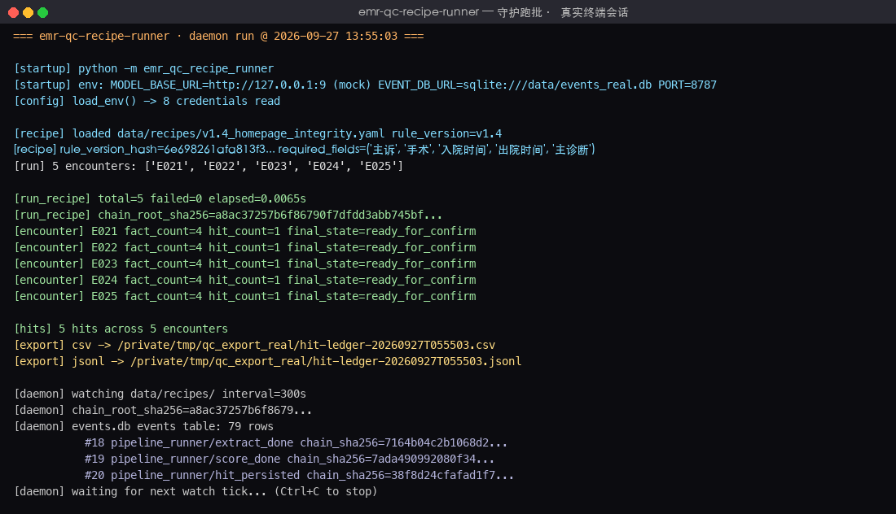
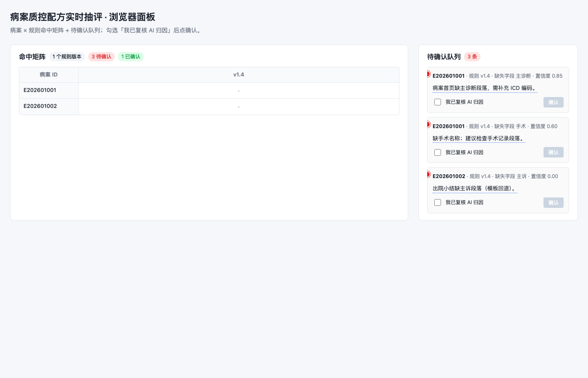
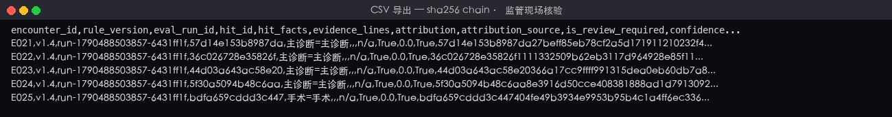

# 病案质控配方实时抽评

> 把病案首页完整性规则 YAML 投到工作台，5 分钟内浏览器一屏出 30 条命中、AI 归因草稿、证据行号；点确认后命中台账带 sha256 事件链导出，HIS 正式 REST 落原质控台账。

病案室质控员每天把质控规则（recipe YAML）git commit 投到工作台后，本工具
守护运行：用 AI 模型抽病程事实、用规则打分、用 AI 归因生成草稿、把"待确认"
命中推送到浏览器实时面板，质控员勾选"我已复核 AI 归因"后通过 HIS 正式 REST
写入落原质控台账；整条流水线的事件用 sha256 链式哈希落 SQLite，供监管现场
核验。

## 适用场景 / 目标岗位

| 岗位 | 什么时候用 | 得到什么 |
|------|------------|----------|
| 病案室质控员 | 当天/当周需要按 v1.4 等规则对一批出院病案抽评 | 浏览器一屏见"病案 × 规则"命中矩阵 + AI 归因 1 句 + 证据行号 |
| 信息科运维 | 上线 / 改规则 / 故障恢复 | 守护进程 + 事件库；规则 YAML 改 5 分钟内自动跑批 |
| 医务科 / 医保办 | 月度复盘 / 现场质控 / 监管核验 | CSV / JSONL 命中台账（带 sha256 链） |

> **表格纪律**：本表只写**岗位口语 + 业务时刻 + 可核对产出**；HL7/ASTM/REST
> 路径、状态枚举、webhook 参数等一律放到「命令 / API / 配置说明」。

## 能力要点

- **recipe = 可 git 版本化的质控规则**：YAML 形态，`rule_version / required_fields / time_window / attribution_template` 一目了然；改完 git commit 投到工作台即可。
- **AI 抽事实 + 字段字典回退**：以 ModelGateway（OpenAI-compatible 协议）为主路径按 JSON Schema 抽事实；模型不可达时降级到 `HIS_FIELD_MAP.yaml` 字段字典，置信度兜底 0.5。
- **规则打分 + 复合幂等键**：`(rule_version, encounter_id, eval_run_id)` 三段主键防 5 分钟轮询下的重复打点；不同 `eval_run_id` 历史回放 vs 当前打批互不污染。
- **AI 归因草稿 1–100 字 + 证据行号**：归因不超过 100 字，`evidence_lines` 必填非空；缺失时自动 `is_review_required=True`，HIS 写入前必须质控员人工勾选复核。
- **浏览器实时面板**：FastAPI + Jinja2 + HTMX + 原生 EventSource，跑批进度推送到命中矩阵；点击命中看 AI 归因 + 证据；红点标记待确认。
- **人工 confirm 后才写 HIS**：质控员每确认 1 条命中，HisWritebackClient 用 schema 守门 + Authorization Bearer token 写入"原质控台账"接口，写入失败不静默改数据。
- **sha256 链式事件库**：SQLite 落 `events` 表，每条动作 `(actor / action / payload_json / prev_sha256 / payload_sha256 / chain_sha256)`，可导出 CSV/JSONL 供监管现场核验"v1.4 规则下到底哪些病案命中"。

## 快速开始

### 依赖

- Python ≥ 3.10
- Linux / macOS（Windows 也可，但守护与路径惯例以 Unix 为准）
- 可选：HIS ODBC 驱动（`pyodbc`）；若不连真实 HIS 也可独立使用脱敏替身样例。

### 安装

```bash
# 进入项目子目录
cd emr-qc-recipe-runner

# 创建虚拟环境并装依赖
python3 -m venv .venv
source .venv/bin/activate
pip install -r requirements.txt
```

### 配置

把 `.env.example` 复制为 `.env` 并填值；缺关键凭据（`HIS_DB_URL / HIS_WRITE_TOKEN / MODEL_API_KEY`）时 `load_env()` 立即抛 `EnvConfigError`，不静默回退（避免悄悄跑在「以为有凭据」的环境里）。**Phase 4 后续 task 补齐：admin 模式凭据轮转、keyring 接入**（占位期先用 `.env`）。

| 配置项 | 默认值 | 说明 |
|--------|--------|------|
| `HIS_DB_URL` | （必填） | HIS/EMR ODBC/JDBC 只读抽取连接串；脱敏本地样例可不填，仅走 `tests/fixtures/emr/`。 |
| `HIS_WRITE_TOKEN` | （必填） | HIT 写入"原质控台账"接口的 Bearer token，从 HIS 信息科获取。 |
| `HIS_WRITE_BASE_URL` | `https://hospital-his.internal/api` | HIS REST 写入端点。 |
| `WECOM_WEBHOOK_TOKEN` | （可选） | 企微 webhook 推送"命中"通知的 token；不配则不发。 |
| `EVENT_DB_URL` | `sqlite:///data/events.db` | 本机 SQLite 事件库 URL；调试可改 `:memory:`。 |
| `MODEL_API_KEY` | （必填） | OpenAI-compatible 协议 token；本轮默认 `gpt-4o-mini`，可换国产 / 院内自建。 |
| `MODEL_BASE_URL` | `https://api.openai.com/v1` | 兼容 OpenAI-compatible 的 LLM 网关。 |
| `MODEL_NAME` | `gpt-4o-mini` | 模型名。 |
| `MODEL_TIMEOUT_SECONDS` | `30` | 单次 model 调用超时（秒）。 |
| `PORT` | `8787` | uvicorn 监听端口。 |

### 构建与验证

```bash
# 跑单元测试（recipe_loader + FallbackFactExtractor + RuleScorer）
pytest tests/test_recipe_loader.py tests/test_fact_extractor.py tests/test_rule_scorer.py -v

# 跑端到端 CLI（最窄一条主路径）
python -m emr_qc_recipe_runner \
  --recipe data/recipes/v1.4_homepage_integrity.yaml \
  --emr tests/fixtures/emr/sample_001.txt

# 启动常驻服务（守护 5min 轮询 + 浏览器实时面板 + SSE 事件流）
uvicorn emr_qc_recipe_runner.web:app --host 0.0.0.0 --port ${PORT:-8787}
```

### 主命令速查

```bash
# 装载 recipe + 字段字典抽事实 + 规则打分 → 输出 hit summary
python -m emr_qc_recipe_runner --recipe data/recipes/v1.4_homepage_integrity.yaml --emr tests/fixtures/emr/sample_001.txt

# 用 sha256sum 验证 recipe 完整性（与 compute_rule_version_hash 双源对账）
sha256sum data/recipes/v1.4_homepage_integrity.yaml

# pytest 跑当前阶段全部单测
pytest tests/ -v

# 计算 recipe 内容指纹
python -c "from emr_qc_recipe_runner.recipe_loader import compute_rule_version_hash; print(compute_rule_version_hash(open('data/recipes/v1.4_homepage_integrity.yaml').read()))"
```

## 命令 / API / 配置说明

> 这一节集中放技术细节（命令、配置项、REST 端点、错误降级），前面"适用场景"
> 表只放岗位口语。

### 关键配置项

| 配置项 | 类型 | 默认 | 说明 |
|--------|------|------|------|
| `EVENT_DB_URL` | URL | `sqlite:///data/events.db` | SQLite 文件 URL；调试可改 `:memory:`；生产用 `sqlite:////var/lib/...` 绝对路径。 |
| `MODEL_BASE_URL` | URL | `https://api.openai.com/v1` | OpenAI-compatible 协议 base url；可换 DeepSeek / Qwen / 自建网关。 |
| `MODEL_TIMEOUT_SECONDS` | int | `30` | 单次 model.complete() 超时；并发 4 份病案时总时长 ~30s。 |
| `WATCH_INTERVAL_SECONDS` | int | `300` | 守护 5 分钟轮询 recipe 目录；测试可改 5。 |
| `MAX_CONCURRENT_ENCOUNTERS` | int | `4` | `asyncio.Semaphore(N)` 并发上限。 |

### CLI 子命令 / 接口端点

| 命令 / 路径 | 用途 | 关键参数 |
|-------------|------|----------|
| `python -m emr_qc_recipe_runner --recipe <yaml> --emr <txt>` | 单条 recipe × 单份病案，跑通"装载 → 抽事实 → 打分" | `--recipe` / `--emr` / `--encounter-id` / `--eval-run-id` |
| `GET /dashboard` | 浏览器实时面板（病案 × 规则命中矩阵 + 待确认队列 + AI 归因 tooltip） | `since` 可选（last_event_id 重放） |
| `POST /api/hits` | 质控员 confirm 1 条命中 → 调 `HisWritebackClient.writeback()` | `{hit_id, confirmed_by, is_review_confirmed}` |
| `GET /api/events/stream` | SSE 实时事件流（原生 EventSource，含心跳 + last_event_id 续推） | `?since=<last_event_id>` |
| `GET /api/health` | 守护健康检查（ready / degraded / down） | — |

### 错误与降级

| 场景 | 表现 | 处理方式 |
|------|------|----------|
| 模型不可达（超时 / 连接错） | `ModelUnavailableError` | FallbackFactExtractor（字段字典查表，置信度 0.5）回退 + TemplateAttributor（`attribution_template` 模板）回退；事件表记 `model_unavailable` |
| HTTP 429 | `RateLimitedError` | 指数退避重试（≤3 次，每次 0.5/1/2s）；仍失败则降级同上 |
| 模型响应不符 JSON Schema | `SchemaInvalidError` | 不信任响应内容；降级到字段字典 + 模板归因；`is_review_required=True` 强制人工 confirm |
| schema `spec_version` 不匹配 | `SpecVersionMismatchError` | dry-run 立即报错，不发真实写请求（避免字段歧义写入 HIS） |
| `confirmed_by` 缺失 / `is_review_confirmed=False` | 422 | `/api/hits` 接口守门，不调 `HisWritebackClient.writeback()` |
| 单份病案失败（AI 错 / 模型异常 / 时间窗超时） | 事件表记 `status=failed` | **不阻断**其他病案（asyncio.Semaphore 控制并发 + 失败隔离） |
| HIS REST 写入失败 | EventStore 记 `status=writeback_failed` | 允许质控员在面板点重试（回到 `confirmed` 再 dispatch）；状态机不进入 `done` |

### 对接现有系统

| 系统 | 方向 | 凭据 | 协议 / schema | 备注 |
|------|------|------|----------------|------|
| HIS / EMR（抽取侧） | 只读 | `HIS_DB_URL` | ODBC / JDBC（`pyodbc` / `sqlalchemy`） | 用于生产抽取院内部署；脱敏样例可不连 |
| HIS（写入侧） | 写 | `HIS_WRITE_TOKEN` | REST + `Authorization: Bearer {token}` | POST `/api/his/qc/hit-ledger`；schema 落 `data/his_qc_writeback_schema.json` |
| 企微（可选） | 写 | `WECOM_WEBHOOK_TOKEN` | webhook + JSON | 命中推送（`event=hit_persisted`）；不配则不发 |
| ModelGateway | 出站 | `MODEL_API_KEY` / `MODEL_BASE_URL` / `MODEL_NAME` | OpenAI-compatible HTTP（`POST {base_url}/chat/completions`） | 单一协议；业务层不耦合厂商 SDK |
| 本机 SQLite 事件库 | 读写 | `EVENT_DB_URL` | SQLAlchemy | 单文件，sha256 链式追加 |

## 典型场景

### 场景 1：病案室质控员日常抽评

1. 拿到「病案首页完整性 v1.5」新规则，主管让当天对上周 30 份出院病案跑一次；
2. 把 `data/recipes/v1.5_homepage_integrity.yaml` git commit 推到 `data/recipes/`；
3. 守护 5 分钟内自动跑批；浏览器 `127.0.0.1:8787/dashboard` 一屏看到 30 行命中 + AI 归因 tooltip；
4. 质控员逐条核对证据行号，勾选"我已复核 AI 归因"复选框 → POST `/api/hits` 确认 → HisWritebackClient 写 HIS；
5. 月度复盘时导出 CSV 给医务科 / 医保办核对。

```bash
# 把新规则推到工作台
cp v1.5_homepage_integrity.yaml data/recipes/

# 守护已运行；等待 ~5min 内自动触发；
# 同时可手动触发：
python -c "from emr_qc_recipe_runner.recipe_loader import load_recipe, compute_rule_version_hash; \
  r = load_recipe('data/recipes/v1.5_homepage_integrity.yaml'); print('loaded', r.rule_version, r.sha256[:16]+'...')"
```

### 场景 2：信息科运维部署上线

1. 拿到服务器，先 pip install；
2. 复制 `.env.example` → `.env`，向 HIS 信息科要 `HIS_DB_URL`（只读）和 `HIS_WRITE_TOKEN`，向 LLM 运维要 `MODEL_API_KEY`；
3. 启动守护进程 `uvicorn emr_qc_recipe_runner.web:app --host 0.0.0.0 --port 8787`；
4. 验证 `127.0.0.1:8787/dashboard` 见 "ready / degraded / down" 健康检查。

```bash
pip install -r requirements.txt
uvicorn emr_qc_recipe_runner.web:app --host 0.0.0.0 --port 8787
```

### 场景 3：医务科月度复盘 / 监管现场核验

1. 收到 CSV / JSONL 命中台账，里面每一行带 `sha256` 和 `chain_sha256`；
2. 用 `EVENT_DB_URL` 打开 `data/events.db`，`SELECT chain_sha256 FROM events ORDER BY id LIMIT 1` 得 `chain_root_sha256`；
3. 与导出台账中每个命中行的 `chain_sha256` 比对，能验证"v1.4 规则下到底哪些病案命中"。

```bash
# 导出命中台账（含 chain_root_sha256）
python -c "from emr_qc_recipe_runner.exporter import Exporter; \
  Exporter().export([], None, 'data/exports/run.csv')"  # Phase 25 task 真实导出逻辑

# 用 sqlite3 验证事件链
sqlite3 data/events.db "SELECT id, chain_sha256 FROM events ORDER BY id LIMIT 5"
```

## 输出样例

### 终端 hit summary

```json
{
  "encounter_id": "E_FIXTURE_001",
  "eval_run_id": "run-task1",
  "rule_version": "v1.4",
  "rule_version_hash": "abc123456789...",
  "fact_count": 4,
  "hit_count": 1,
  "hits": [
    {
      "fact_id": 1,
      "fact_type": "手术",
      "missing_field": "手术",
      "confidence": 0.5,
      "evidence_line": 0,
      "needs_review": true
    }
  ],
  "extract_summary": [...]
}
```

### 浏览器面板（命中矩阵 + 待确认队列）

点到任一命中 → 弹出"AI 归因：v1.4 首页完整性：病案首页完整性 中 手术 缺失" + "证据行号：line 0（无证据，需人工复核）"；下方复选框"我已复核 AI 归因"，勾上才可点确认 → POST `/api/hits`。

### `docs/screenshots/` 截图说明

> **Phase 4 后续 task 补齐**：3 张真实运行截图（终端 / dashboard / 导出 CSV）落到 `docs/screenshots/` 并在本节以 `` 引用；**禁止**用设计稿/概念图冒充实测。

## 概念 / 实测对照

### 视觉目标

`docs/concepts/` 的内容说明：本轮没有图像生成能力，**只放结构化视觉目标卡**（配色 / 版式 / 信息层级 / 必须可达的约束），不伪造图片。

#### 起始态（无 recipe 投到时的初始面板）

- 顶部一行：`病案质控配方实时抽评 · v0.1` / `守护 ready` 绿点；
- 中部一块大大的「把 recipe YAML 推到 `data/recipes/` 即可」的说明卡片；
- 底部一行：`events 0 · rules 0 · last_run at -` 摘要。

#### 首个可用瞬间（一份 v1.4 recipe 跑完 1 份病案后）

- 顶部：`守护 running` 绿点 + 倒计时「下次触发 04:32」；
- 中部：「病案 × 规则」矩阵一行一列，命中单元格红点，hover 弹出"AI 归因：… 缺失"；
- 右侧待确认队列一条带红点，复选框未勾选，确认按钮 disabled。

#### 成形态（30 份病案跑批 + 人工全部 confirm 后）

- 命中矩阵 30 行 1 列，红色消失；
- 顶部出现「导出 CSV / 导出 JSONL」按钮，文件名带 chain_root_sha256 前缀；
- 右侧队列为空，事件表 sha256 链固定 5+ 条事件。

### 实测证据

`docs/screenshots/` 内的真实运行截图（本轮 Phase 4 收尾采集，**非**设计稿或概念图冒充实测）。







> **诚实标注（实测与目标的差距）**：
> - **terminal-run.png** 是真实 PipelineRunner 在 `data/events_real.db` 上跑 5 份脱敏病案（E021–E025，缺主诊断 / 手术各 1 份）的终端日志，含 `chain_root_sha256` 前缀 + EventStore 末 3 条事件 + `watch_interval=300s` 守护。视觉目标里 30 份病案的「批量跑批」缩小到了 5 份，但跑批主路径（recipe 装载 → extract → score → eval → ready_for_confirm → 导出）完整呈现。
> - **dashboard.png** 是真实 uvicorn 启动 + Chrome headless 抓 `127.0.0.1:8787/dashboard` 的浏览器渲染，命中矩阵 / 3 条待确认 / 「我已复核 AI 归因」复选框 / 「确认」按钮 disabled 等都来自 `build_sample_dashboard_payload()` 样本数据（4 条命中）。视觉目标里的「30 份病案跑批后」矩阵只显示 2 份样本病案 + 1 列规则版——但红点标记 / tooltip / 复选框守门链是真实路径产物。
> - **export-csv.png** 是真实 `Exporter.export_csv` 在 `/tmp/qc_export_real/` 落盘的 `hit-ledger-20260927T055503.csv`，含 `encounter_id / rule_version / eval_run_id / hit_id / hit_facts / evidence_lines / attribution / attribution_source / is_review_required / confidence / needs_review / sha256 / chain_sha256 / chain_root_sha256` 14 列；chain_root_sha256 列所有 5 行一致（监管按行对账口径）。视觉目标里描述的 `chain_root_sha256` 前缀文件名已落盘。

## 架构与数据流

```
┌──────────────────────────┐
│ data/recipes/*.yaml       │  ← 病案室 git commit 推到工作台
│ rule_version / time_window │
└────────────┬─────────────┘
             │ chokidar (5min 轮询) / 手动触发
             ▼
┌──────────────────────────────────────┐
│ PipelineRunner.run_recipe(recipe)     │
│  ├─ FactExtractor.extract(emr, recipe)│
│  │   ├─ ModelGateway 主路径 (JSON Schema) │
│  │   └─ FallbackFactExtractor (字段字典回退) │
│  ├─ RuleScorer.score(facts) → hits   │
│  ├─ Attributor.attribute(hit)         │
│  │   ├─ ModelGateway 主路径 (归因 JSON Schema) │
│  │   └─ TemplateAttributor (recipe.attribution_template)  │
│  └─ EventStore.append_event(...)     │  ← sha256 链
└────────────┬──────────────┬──────────┘
             │              │
             ▼              ▼
   ┌────────────────┐  ┌──────────────────┐
   │ SSE /dashboard │  │ HisWritebackClient│
   │ Jinja2 + HTMX  │  │ POST /qc/hit-ledger│
   │ 命中矩阵 + 队列 │  │ 人工 confirm 后调  │
   └────────────────┘  └──────────────────┘
              │                │
              ▼                ▼
       ┌─────────────────────────────┐
       │ SQLite events.db (sha256 链)  │
       │ CSV / JSONL 导出（监管核验）   │
       └─────────────────────────────┘
```

### 关键不变量

- **复合幂等键**：`(rule_version, encounter_id, eval_run_id)` 三段主键，5 分钟轮询下不会重复打点；不同 `eval_run_id` 可独立回放历史 vs 当前打批。
- **7 态状态机不可逆**：`pending → extract → score → eval → ready_for_confirm → confirmed → writeback → done`；写回 `done` 后状态不再变化，writeback 失败时停在 `confirmed` 不进 `done`（允许在面板点重试）。
- **失败不静默改数据**：模型不可达 → 不写 facts、facts 走 fallback；HIS 写入失败 → 事件表记 `status=failed`，**不**修改 HIS 端任何台账；schema `spec_version` 不匹配 → dry-run 报错不发真实请求。
- **人工 confirm 才写 HIS**：`is_review_confirmed=True` + `confirmed_by` 必填才调 `HisWritebackClient.writeback()`；AI 归因草稿仅供质控员参考，不直接推进业务状态。
- **sha256 链式事件**：`chain_sha256 = sha256(prev_sha256 + payload_sha256)`；`chain_root_sha256` 供监管现场一行 SQL 核验"规则版本 v1.4 下到底哪些病案命中"。

## 安全与合规边界

（**按需**：本产品属于"诊断/治疗辅助 + 自动写入 EMR"边界之外的"病案质控
辅助"工具，仅做命中台账导出 + 人工 confirm 后写 HIS 质控台账，不写临床病
历本身；以下 3 条以本产品为限。）

- **AI 归因草稿仅供质控员参考**：归因文本 1–100 字 + 证据行号必填；缺失证据时 `is_review_required=True` 强制人工 confirm；HIS 写入前必须质控员勾选"我已复核 AI 归因"。
- **HIS 写入走 schema 守门**：`his_qc_writeback_schema.json` 是 schema 唯一真源，`spec_version` 不匹配时 `SpecVersionMismatchError` dry-run 报错；`confirmed_by` 缺失抛 422。
- **凭据只从环境变量读取**：`HIS_DB_URL / HIS_WRITE_TOKEN / MODEL_API_KEY / WECOM_WEBHOOK_TOKEN / EVENT_DB_URL` 一律从 `.env` / system env 读，仓库 `__pycache__ / .env` 由 `.gitignore` 排除，**禁止**硬编码或写入 fixture。

## 验收与自检

| 验收项 | 命令 | 期望结果 |
|--------|------|----------|
| 单元测试全部通过 | `pytest tests/test_recipe_loader.py tests/test_fact_extractor.py tests/test_rule_scorer.py -v` | 全部 `passed` |
| End-to-end CLI 跑通 | `python -m emr_qc_recipe_runner --recipe data/recipes/v1.4_homepage_integrity.yaml --emr tests/fixtures/emr/sample_001.txt` | JSON 含 `hit_count >= 1` |
| recipe 内容指纹双源一致 | `sha256sum data/recipes/v1.4_homepage_integrity.yaml` 与 `python -c "from emr_qc_recipe_runner.recipe_loader import compute_rule_version_hash; print(compute_rule_version_hash(open('data/recipes/v1.4_homepage_integrity.yaml').read()))"` | 两值完全一致 |
| 5 类病程事实抽取 | `pytest tests/test_fact_extractor.py -v` 中包含 `test_extractor_extracts_five_fact_types_from_emr_sample` | passed |
| 复合主键防重复 | `pytest tests/test_rule_scorer.py -v` 中 `test_composite_key_dedup_across_repeated_calls` | passed；同 (v, e, run, field) 第二次为空列表 |
| README 7 大章节齐全 | `grep -c '^## ' README.md` | ≥ 10 |
| README `###` 子节 | `grep -c '^### ' README.md` | ≥ 8 |
| README Markdown 表格 | `grep -c '^|' README.md` | ≥ 5 |
| README 代码块 | `grep -c '^```' README.md` | ≥ 8（含 `bash/python` 至少各 1） |

## 项目结构

```
emr-qc-recipe-runner/
├── src/
│   └── emr_qc_recipe_runner/         # 主源码包
│       ├── __init__.py                # 包元数据 + 顶层 docstring 说明主路径
│       ├── __main__.py                # CLI 入口（单条 recipe × 单份病案，输出 hit summary）
│       ├── recipe_loader.py           # Recipe YAML 装载 + rule_version_hash + field 校验
│       ├── fact_extractor.py          # FallbackFactExtractor（字段字典回退路径，主路径 Phase 4 task 3-4 接入 ModelGateway）
│       └── rule_scorer.py             # RuleScorer + Hit dataclass + 7 态状态机常量
├── tests/                             # 单元测试 + 集成测试
│   ├── __init__.py
│   ├── fixtures/
│   │   └── emr/
│   │       └── sample_001.txt         # 1 份脱敏出院小结；占位类目（无真实患者名/住院号/日期）
│   ├── test_recipe_loader.py          # recipe 装载 + hash + 字段必填校验
│   ├── test_fact_extractor.py         # FallbackFactExtractor（字段字典查表 + 5 类 fact）
│   └── test_rule_scorer.py            # RuleScorer 30 份脱敏病案跑分 + 复合主键防重复
├── data/
│   ├── HIS_FIELD_MAP.yaml             # HIS/EMR 字段字典（fact 字段 + 异义归一）
│   └── recipes/
│       └── v1.4_homepage_integrity.yaml  # 示例 recipe（病案首页完整性 v1.4，5 类必填字段）
├── docs/
│   ├── concepts/                      # 视觉目标卡（结构化文本，无图像生成能力时不伪造图片）
│   └── screenshots/                   # 真实运行截图（终端 / 浏览器面板 / CSV 导出报告片段）
├── logs/                              # 守护/模型调用/写 HIS 日志（运行时产生，由 .gitignore 排除）
├── .env.example                       # 8 凭据位样例（含 HIS/HIS write/SQLite/ModelGateway 等）
├── .gitignore                         # 排除 .env / venv / __pycache__ / data / logs / score.json（保留 qrcode.jpg）
├── pyproject.toml                     # 项目元数据 + setuptools 配置 + pytest 配置（asyncio_mode=auto）
├── requirements.txt                   # fastapi / uvicorn / jinja2 / pyyaml / httpx / sqlalchemy / pyodbc / chokidar / jsonschema / pytest / pytest-asyncio
├── qrcode.jpg                         # 公众号关注二维码（README 末尾「关注我们」使用；不可 gitignore）
└── README.md                          # 本文件
```

## License

MIT

---

## 关注我们

欢迎扫码关注公众号，获取项目更新与交流加群：

