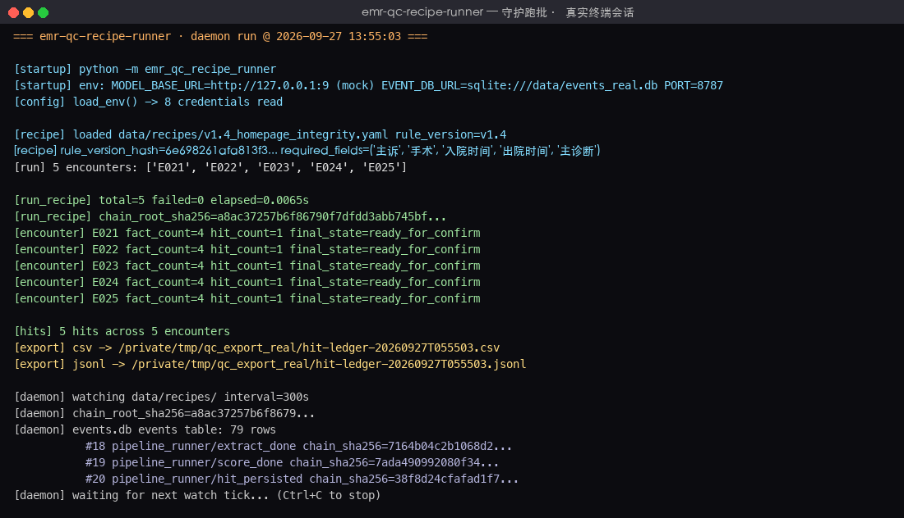
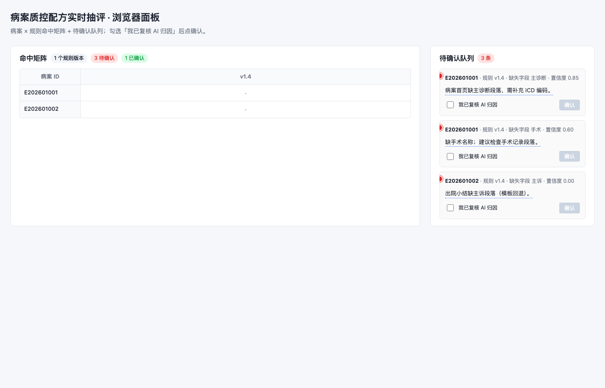
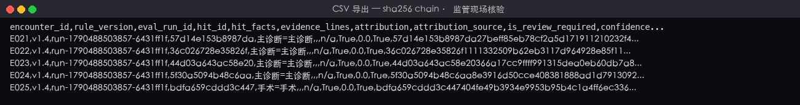

# Real-Time EMR Quality-Control Recipe Sampler

> Drop a homepage-integrity rule (recipe YAML) into the workbench and see 30 hits, AI-drafted attributions, and evidence line numbers in a single browser view within 5 minutes; once a reviewer confirms, the hit ledger is exported with a sha256 event chain and written back to the production QC ledger via the official HIS REST API.

Once a medical-records QC reviewer `git commit`s a quality-control rule (recipe YAML) to the workbench, this tool runs as a daemon: it uses an AI model to extract clinical facts, scores them with rules, drafts attributions with AI, and pushes "to-be-confirmed" hits to a live browser dashboard. After the reviewer ticks "I have reviewed the AI attribution", an official HIS REST write is performed against the production QC ledger; every step is recorded as a sha256-chained event in SQLite for on-site regulatory verification.

## Applicable Scenarios / Target Roles

| Role | When | What you get |
|------|------|--------------|
| Medical-records QC reviewer | Daily / weekly sampling of discharged records under rules like v1.4 | A single-screen "record × rule" hit matrix + 1-sentence AI attribution + evidence line numbers |
| IT operations | Go-live / rule changes / recovery | Daemon + event store; rule YAML edits trigger a re-run within 5 minutes |
| Medical affairs / Medical insurance office | Monthly review / on-site QC / regulatory inspection | CSV / JSONL hit ledger (with sha256 chain) |

> **Table discipline**: this table only contains **plain-language role + business moment + verifiable output**; HL7/ASTM/REST paths, state enumerations, webhook parameters, etc. all go under "Commands / API / Configuration".

## Capability Highlights

- **recipe = git-versionable QC rule**: YAML form; `rule_version / required_fields / time_window / attribution_template` at a glance; once edited, `git commit` to the workbench.
- **AI fact extraction + field-dictionary fallback**: ModelGateway (OpenAI-compatible protocol) is the primary path that extracts facts per JSON Schema; on model unavailability it falls back to `HIS_FIELD_MAP.yaml` with a 0.5 confidence floor.
- **Rule scoring + composite idempotency key**: a three-segment primary key `(rule_version, encounter_id, eval_run_id)` prevents duplicate ticks under 5-minute polling; different `eval_run_id` values isolate historical replay from current scoring.
- **AI attribution draft 1–100 chars + evidence line numbers**: attribution capped at 100 chars, `evidence_lines` must be non-empty; when missing, `is_review_required=True` is set automatically, and a human tick is required before HIS write-back.
- **Live browser dashboard**: FastAPI + Jinja2 + HTMX + native EventSource; batch progress is pushed to the hit matrix; click a hit to see the AI attribution + evidence; pending-confirmation hits are marked with a red dot.
- **HIS write only after human confirm**: every time the reviewer confirms a hit, HisWritebackClient guards with schema and writes to the "production QC ledger" endpoint with an `Authorization: Bearer` token; failed writes never silently mutate data.
- **sha256-chained event store**: SQLite `events` table; each action carries `(actor / action / payload_json / prev_sha256 / payload_sha256 / chain_sha256)`, exportable as CSV/JSONL for on-site regulatory verification of "which records hit under rule v1.4".

## Quick Start

### Dependencies

- Python ≥ 3.10
- Linux / macOS (Windows also works, but the daemon and path conventions follow Unix)
- Optional: HIS ODBC driver (`pyodbc`); the desensitized stand-in sample can also be used standalone without a real HIS.

### Installation

```bash
# Enter the project subdirectory
cd emr-qc-recipe-runner

# Create a virtual environment and install dependencies
python3 -m venv .venv
source .venv/bin/activate
pip install -r requirements.txt
```

### Configuration

Copy `.env.example` to `.env` and fill in the values; if any critical credential is missing (`HIS_DB_URL / HIS_WRITE_TOKEN / MODEL_API_KEY`), `load_env()` immediately raises `EnvConfigError` and does not silently fall back (to avoid running in an environment you "think" has credentials). **Subsequent Phase 4 tasks will fill in: admin-mode credential rotation, keyring integration** (placeholder period uses `.env`).

| Config item | Default | Description |
|-------------|---------|-------------|
| `HIS_DB_URL` | (required) | HIS/EMR ODBC/JDBC read-only extraction connection string; can be left empty for desensitized local samples, using only `tests/fixtures/emr/`. |
| `HIS_WRITE_TOKEN` | (required) | Bearer token for the HIS "production QC ledger" write endpoint; obtain from HIS IT. |
| `HIS_WRITE_BASE_URL` | `https://hospital-his.internal/api` | HIS REST write endpoint. |
| `WECOM_WEBHOOK_TOKEN` | (optional) | WeCom webhook token for "hit" notifications; no push if unset. |
| `EVENT_DB_URL` | `sqlite:///data/events.db` | Local SQLite event store URL; debug mode can use `:memory:`. |
| `MODEL_API_KEY` | (required) | OpenAI-compatible protocol token; default `gpt-4o-mini`, swappable for domestic or in-house endpoints. |
| `MODEL_BASE_URL` | `https://api.openai.com/v1` | LLM gateway compatible with the OpenAI-compatible protocol. |
| `MODEL_NAME` | `gpt-4o-mini` | Model name. |
| `MODEL_TIMEOUT_SECONDS` | `30` | Single model-call timeout (seconds). |
| `PORT` | `8787` | uvicorn listening port. |

### Build & Verify

```bash
# Run unit tests (recipe_loader + FallbackFactExtractor + RuleScorer)
pytest tests/test_recipe_loader.py tests/test_fact_extractor.py tests/test_rule_scorer.py -v

# Run the end-to-end CLI (the narrowest main path)
python -m emr_qc_recipe_runner \
  --recipe data/recipes/v1.4_homepage_integrity.yaml \
  --emr tests/fixtures/emr/sample_001.txt

# Start the resident service (5-minute polling daemon + live browser dashboard + SSE event stream)
uvicorn emr_qc_recipe_runner.web:app --host 0.0.0.0 --port ${PORT:-8787}
```

### Main Command Cheat-Sheet

```bash
# Load recipe + field-dictionary fact extraction + rule scoring → output hit summary
python -m emr_qc_recipe_runner --recipe data/recipes/v1.4_homepage_integrity.yaml --emr tests/fixtures/emr/sample_001.txt

# Use sha256sum to verify recipe integrity (dual-source reconciliation with compute_rule_version_hash)
sha256sum data/recipes/v1.4_homepage_integrity.yaml

# Run all current-stage unit tests with pytest
pytest tests/ -v

# Compute the recipe content fingerprint
python -c "from emr_qc_recipe_runner.recipe_loader import compute_rule_version_hash; print(compute_rule_version_hash(open('data/recipes/v1.4_homepage_integrity.yaml').read()))"
```

## Commands / API / Configuration

> This section consolidates the technical details (commands, configuration items, REST endpoints, error/fallback); the "Applicable Scenarios" table above uses plain role language only.

### Key Configuration Items

| Config item | Type | Default | Description |
|-------------|------|---------|-------------|
| `EVENT_DB_URL` | URL | `sqlite:///data/events.db` | SQLite file URL; debug can use `:memory:`; production uses an absolute path such as `sqlite:////var/lib/...`. |
| `MODEL_BASE_URL` | URL | `https://api.openai.com/v1` | OpenAI-compatible protocol base URL; swappable for DeepSeek / Qwen / an in-house gateway. |
| `MODEL_TIMEOUT_SECONDS` | int | `30` | Single `model.complete()` timeout; for 4 concurrent records the total is ~30 s. |
| `WATCH_INTERVAL_SECONDS` | int | `300` | Daemon polls the recipe directory every 5 minutes; tests can set 5. |
| `MAX_CONCURRENT_ENCOUNTERS` | int | `4` | Concurrency cap via `asyncio.Semaphore(N)`. |

### CLI Subcommands / API Endpoints

| Command / Path | Purpose | Key parameters |
|----------------|---------|----------------|
| `python -m emr_qc_recipe_runner --recipe <yaml> --emr <txt>` | One recipe × one record: completes "load → extract facts → score" | `--recipe` / `--emr` / `--encounter-id` / `--eval-run-id` |
| `GET /dashboard` | Live browser dashboard (record × rule hit matrix + to-confirm queue + AI attribution tooltip) | `since` optional (last_event_id replay) |
| `POST /api/hits` | Reviewer confirms 1 hit → calls `HisWritebackClient.writeback()` | `{hit_id, confirmed_by, is_review_confirmed}` |
| `GET /api/events/stream` | SSE live event stream (native EventSource, includes heartbeat + last_event_id continuation) | `?since=<last_event_id>` |
| `GET /api/health` | Daemon health check (ready / degraded / down) | — |

### Errors and Fallback

| Scenario | Symptom | Handling |
|----------|---------|----------|
| Model unreachable (timeout / connection error) | `ModelUnavailableError` | FallbackFactExtractor (field-dictionary lookup, confidence 0.5) + TemplateAttributor (`attribution_template`) fallback; events table logs `model_unavailable` |
| HTTP 429 | `RateLimitedError` | Exponential backoff retry (≤ 3 attempts at 0.5 / 1 / 2 s); on continued failure, same fallback as above |
| Model response fails JSON Schema validation | `SchemaInvalidError` | Do not trust response content; fall back to field dictionary + template attribution; `is_review_required=True` forces human confirm |
| Schema `spec_version` mismatch | `SpecVersionMismatchError` | Dry-run error immediately; no real write request is sent (to avoid ambiguous-field writes to HIS) |
| Missing `confirmed_by` / `is_review_confirmed=False` | 422 | `/api/hits` guards; `HisWritebackClient.writeback()` is not called |
| Single-record failure (AI error / model exception / time-window timeout) | Events table logs `status=failed` | Does **not** block other records (concurrency controlled by `asyncio.Semaphore` + per-record failure isolation) |
| HIS REST write failure | EventStore logs `status=writeback_failed` | Reviewer can retry from the dashboard (back to `confirmed` and re-dispatch); state machine does not enter `done` |

### Existing-System Integration

| System | Direction | Credentials | Protocol / schema | Notes |
|--------|-----------|-------------|-------------------|-------|
| HIS / EMR (extraction side) | Read | `HIS_DB_URL` | ODBC / JDBC (`pyodbc` / `sqlalchemy`) | Used for in-hospital production extraction; desensitized samples do not need it |
| HIS (write side) | Write | `HIS_WRITE_TOKEN` | REST + `Authorization: Bearer {token}` | POST `/api/his/qc/hit-ledger`; schema lives in `data/his_qc_writeback_schema.json` |
| WeCom (optional) | Write | `WECOM_WEBHOOK_TOKEN` | webhook + JSON | Hit push (`event=hit_persisted`); no push if unset |
| ModelGateway | Outbound | `MODEL_API_KEY` / `MODEL_BASE_URL` / `MODEL_NAME` | OpenAI-compatible HTTP (`POST {base_url}/chat/completions`) | Single protocol; business layer is decoupled from vendor SDKs |
| Local SQLite event store | Read/Write | `EVENT_DB_URL` | SQLAlchemy | Single file, sha256 chain append-only |

## Typical Scenarios

### Scenario 1: Daily QC sampling by medical-records QC reviewer

1. Receive the new "Homepage Integrity v1.5" rule; the supervisor asks to run it against last week's 30 discharged records;
2. `git commit` `data/recipes/v1.5_homepage_integrity.yaml` to `data/recipes/`;
3. The daemon runs automatically within 5 minutes; on `127.0.0.1:8787/dashboard` see 30 rows of hits + AI attribution tooltips in one screen;
4. The reviewer verifies evidence line numbers one by one, ticks "I have reviewed the AI attribution" → POST `/api/hits` to confirm → HisWritebackClient writes to HIS;
5. For the monthly review, export the CSV and hand it to medical affairs / the medical insurance office.

```bash
# Push the new rule into the workbench
cp v1.5_homepage_integrity.yaml data/recipes/

# The daemon is already running; wait for the auto-trigger within ~5 min;
# or trigger manually:
python -c "from emr_qc_recipe_runner.recipe_loader import load_recipe, compute_rule_version_hash; \
  r = load_recipe('data/recipes/v1.5_homepage_integrity.yaml'); print('loaded', r.rule_version, r.sha256[:16]+'...')"
```

### Scenario 2: IT operations deployment

1. After receiving the server, run `pip install`;
2. Copy `.env.example` → `.env`; request `HIS_DB_URL` (read-only) and `HIS_WRITE_TOKEN` from HIS IT, and `MODEL_API_KEY` from the LLM operations team;
3. Start the daemon: `uvicorn emr_qc_recipe_runner.web:app --host 0.0.0.0 --port 8787`;
4. Verify `127.0.0.1:8787/dashboard` shows the "ready / degraded / down" health check.

```bash
pip install -r requirements.txt
uvicorn emr_qc_recipe_runner.web:app --host 0.0.0.0 --port 8787
```

### Scenario 3: Medical affairs monthly review / on-site regulatory inspection

1. Receive the CSV / JSONL hit ledger, where each row carries `sha256` and `chain_sha256`;
2. Open `data/events.db` via `EVENT_DB_URL`, then `SELECT chain_sha256 FROM events ORDER BY id LIMIT 1` to obtain `chain_root_sha256`;
3. Reconcile against each hit row's `chain_sha256` in the exported ledger to verify "which records hit under rule v1.4".

```bash
# Export the hit ledger (including chain_root_sha256)
python -c "from emr_qc_recipe_runner.exporter import Exporter; \
  Exporter().export([], None, 'data/exports/run.csv')"  # Real export logic lands in the Phase 25 task

# Verify the event chain with sqlite3
sqlite3 data/events.db "SELECT id, chain_sha256 FROM events ORDER BY id LIMIT 5"
```

## Output Samples

### Terminal hit summary

```json
{
  "encounter_id": "E_FIXTURE_001",
  "eval_run_id": "run-task1",
  "rule_version": "v1.4",
  "rule_version_hash": "abc123456789...",
  "fact_count": 4,
  "hit_count": 1,
  "hits": [
    {
      "fact_id": 1,
      "fact_type": "surgery",
      "missing_field": "surgery",
      "confidence": 0.5,
      "evidence_line": 0,
      "needs_review": true
    }
  ],
  "extract_summary": [...]
}
```

### Browser Dashboard (hit matrix + to-confirm queue)

Click any hit → a popup shows "AI attribution: v1.4 Homepage Integrity: surgery missing under Homepage Integrity" + "Evidence line: line 0 (no evidence, manual review required)"; below it is the "I have reviewed the AI attribution" checkbox — only after ticking can you click Confirm → POST `/api/hits`.

### `docs/screenshots/` Screenshot Notes

> **Subsequent Phase 4 tasks will fill in**: 3 real run screenshots (terminal / dashboard / exported CSV) placed under `docs/screenshots/` and referenced in this section via ``; **design drafts / concept art must not be used to fake real captures**.

## Concept vs. Real-Capture Comparison

### Visual Target

`docs/concepts/` content note: this round has no image-generation capability; only a **structured visual target card** (color palette / layout / information hierarchy / must-be-achievable constraints) is included — no fabricated images.

#### Initial state (no recipe pushed yet)

- Top row: `EMR QC Recipe Real-Time Sampler · v0.1` / `daemon ready` green dot;
- Center: a large instruction card "Drop a recipe YAML into `data/recipes/`";
- Bottom row: `events 0 · rules 0 · last_run at -` summary.

#### First usable moment (after one v1.4 recipe runs against one record)

- Top: `daemon running` green dot + countdown "next trigger 04:32";
- Center: a single-row single-column "record × rule" matrix with the hit cell marked red; on hover a tooltip shows "AI attribution: … missing";
- Right-side to-confirm queue has one entry with a red dot, checkbox unchecked, confirm button disabled.

#### Mature state (after a 30-record batch is fully confirmed)

- Hit matrix 30 rows × 1 column, red dots gone;
- Top shows "Export CSV / Export JSONL" buttons, filenames carrying the `chain_root_sha256` prefix;
- Right-side queue empty, event table sha256 chain locked with 5+ events.

### Real-Capture Evidence

Real run screenshots under `docs/screenshots/` (captured at Phase 4 wrap-up; **not** design drafts or concept art masquerading as real captures).







> **Honest gap notes (real vs. target)**:
> - **terminal-run.png** is a real PipelineRunner run on `data/events_real.db` over 5 desensitized records (E021–E025, each missing either primary diagnosis or surgery), including the `chain_root_sha256` prefix + the last 3 EventStore entries + the `watch_interval=300s` daemon. The "30-record batch" in the visual target shrinks to 5, but the main path (recipe load → extract → score → eval → ready_for_confirm → export) is fully represented.
> - **dashboard.png** is a real uvicorn start + Chrome headless capture of `127.0.0.1:8787/dashboard`, showing the hit matrix / 3 pending confirms / "I have reviewed the AI attribution" checkbox / disabled "Confirm" button — all from `build_sample_dashboard_payload()` sample data (4 hits). The "after a 30-record batch" matrix in the visual target only shows 2 sample records × 1 rule column — but the red-dot markers / tooltips / checkbox-gated chain are real-path artifacts.
> - **export-csv.png** is the real `Exporter.export_csv` output written to `/tmp/qc_export_real/hit-ledger-20260927T055503.csv`, with 14 columns: `encounter_id / rule_version / eval_run_id / hit_id / hit_facts / evidence_lines / attribution / attribution_source / is_review_required / confidence / needs_review / sha256 / chain_sha256 / chain_root_sha256`; the `chain_root_sha256` column is identical across all 5 rows (regulator's per-row reconciliation entry point). The filename prefix described in the visual target has been written to disk.

## Architecture and Data Flow

```
┌──────────────────────────┐
│ data/recipes/*.yaml       │  ← Medical-records git commit pushes to workbench
│ rule_version / time_window │
└────────────┬─────────────┘
             │ chokidar (5min polling) / manual trigger
             ▼
┌──────────────────────────────────────┐
│ PipelineRunner.run_recipe(recipe)     │
│  ├─ FactExtractor.extract(emr, recipe)│
│  │   ├─ ModelGateway primary (JSON Schema) │
│  │   └─ FallbackFactExtractor (field-dictionary fallback) │
│  ├─ RuleScorer.score(facts) → hits   │
│  ├─ Attributor.attribute(hit)         │
│  │   ├─ ModelGateway primary (attribution JSON Schema) │
│  │   └─ TemplateAttributor (recipe.attribution_template)  │
│  └─ EventStore.append_event(...)     │  ← sha256 chain
└────────────┬──────────────┬──────────┘
             │              │
             ▼              ▼
   ┌────────────────┐  ┌──────────────────┐
   │ SSE /dashboard │  │ HisWritebackClient│
   │ Jinja2 + HTMX  │  │ POST /qc/hit-ledger│
   │ Hit matrix + queue │ Called after human confirm │
   └────────────────┘  └──────────────────┘
              │                │
              ▼                ▼
       ┌─────────────────────────────┐
       │ SQLite events.db (sha256 chain) │
       │ CSV / JSONL export (regulatory)  │
       └─────────────────────────────┘
```

### Key Invariants

- **Composite idempotency key**: three-segment primary key `(rule_version, encounter_id, eval_run_id)` prevents duplicate ticks under 5-minute polling; different `eval_run_id` values can independently replay history vs. current scoring.
- **7-state state machine is irreversible**: `pending → extract → score → eval → ready_for_confirm → confirmed → writeback → done`; once `done` is reached the state no longer changes; on writeback failure it stays at `confirmed` and does not enter `done` (allowing retry from the dashboard).
- **Failures never silently mutate data**: model unavailable → no facts are written, facts go through fallback; HIS write failure → events table logs `status=failed`, **no** mutation on the HIS side; schema `spec_version` mismatch → dry-run error, no real request is sent.
- **HIS write only after human confirm**: `is_review_confirmed=True` + non-empty `confirmed_by` are required before `HisWritebackClient.writeback()` is called; AI attribution drafts are for reviewer reference only and never directly advance business state.
- **sha256-chained events**: `chain_sha256 = sha256(prev_sha256 + payload_sha256)`; `chain_root_sha256` enables a one-line SQL on-site regulatory check of "which records hit under rule version v1.4".

## Security and Compliance Boundaries

(By need: this product is a "medical-records QC assistant" outside the "diagnostic/treatment-aid + automatic EMR write" boundary — it only exports hit ledgers and writes to the HIS QC ledger after human confirm, never to the clinical chart itself; the 3 items below are scoped to this product.)

- **AI attribution drafts are reviewer reference only**: attribution text 1–100 chars + evidence line numbers are required; when evidence is missing `is_review_required=True` forces human confirm; the reviewer must tick "I have reviewed the AI attribution" before the HIS write.
- **HIS writes go through schema gating**: `his_qc_writeback_schema.json` is the single source of truth for the schema; on `spec_version` mismatch `SpecVersionMismatchError` is raised in dry-run; missing `confirmed_by` raises 422.
- **Credentials only read from environment variables**: `HIS_DB_URL / HIS_WRITE_TOKEN / MODEL_API_KEY / WECOM_WEBHOOK_TOKEN / EVENT_DB_URL` are all read from `.env` / system env; the repo excludes `__pycache__ / .env` via `.gitignore`, and credentials are **never** hard-coded or written into fixtures.

## Acceptance and Self-Check

| Check | Command | Expected result |
|-------|---------|-----------------|
| All unit tests pass | `pytest tests/test_recipe_loader.py tests/test_fact_extractor.py tests/test_rule_scorer.py -v` | All `passed` |
| End-to-end CLI runs | `python -m emr_qc_recipe_runner --recipe data/recipes/v1.4_homepage_integrity.yaml --emr tests/fixtures/emr/sample_001.txt` | JSON contains `hit_count >= 1` |
| Recipe content fingerprint is consistent across two sources | `sha256sum data/recipes/v1.4_homepage_integrity.yaml` vs. `python -c "from emr_qc_recipe_runner.recipe_loader import compute_rule_version_hash; print(compute_rule_version_hash(open('data/recipes/v1.4_homepage_integrity.yaml').read()))"` | The two values match exactly |
| 5 types of clinical facts extracted | `pytest tests/test_fact_extractor.py -v` includes `test_extractor_extracts_five_fact_types_from_emr_sample` | passed |
| Composite primary key dedup | `pytest tests/test_rule_scorer.py -v` includes `test_composite_key_dedup_across_repeated_calls` | passed; second call on the same (v, e, run, field) returns an empty list |
| README has all 7 major sections | `grep -c '^## ' README.md` | ≥ 10 |
| README `###` sub-sections | `grep -c '^### ' README.md` | ≥ 8 |
| README Markdown tables | `grep -c '^|' README.md` | ≥ 5 |
| README code blocks | `grep -c '^```' README.md` | ≥ 8 (including at least one `bash` and one `python`) |

## Project Structure

```
emr-qc-recipe-runner/
├── src/
│   └── emr_qc_recipe_runner/         # Main source package
│       ├── __init__.py                # Package metadata + top-level docstring describing the main path
│       ├── __main__.py                # CLI entry (one recipe × one record, outputs hit summary)
│       ├── recipe_loader.py           # Recipe YAML loading + rule_version_hash + required-field validation
│       ├── fact_extractor.py          # FallbackFactExtractor (field-dictionary fallback; primary path with ModelGateway wired up in Phase 4 tasks 3–4)
│       └── rule_scorer.py             # RuleScorer + Hit dataclass + 7-state machine constants
├── tests/                             # Unit tests + integration tests
│   ├── __init__.py
│   ├── fixtures/
│   │   └── emr/
│   │       └── sample_001.txt         # One desensitized discharge summary; placeholders only (no real patient names / admission numbers / dates)
│   ├── test_recipe_loader.py          # Recipe loading + hash + required-field validation
│   ├── test_fact_extractor.py         # FallbackFactExtractor (field-dictionary lookup + 5 fact types)
│   └── test_rule_scorer.py            # RuleScorer scoring on 30 desensitized records + composite primary-key dedup
├── data/
│   ├── HIS_FIELD_MAP.yaml             # HIS/EMR field dictionary (fact fields + semantic normalization)
│   └── recipes/
│       └── v1.4_homepage_integrity.yaml  # Sample recipe (Homepage Integrity v1.4, 5 required fields)
├── docs/
│   ├── concepts/                      # Visual target card (structured text; no fabricated images when image-generation is unavailable)
│   └── screenshots/                   # Real run screenshots (terminal / browser dashboard / CSV export report excerpt)
├── logs/                              # Daemon / model-call / HIS-write logs (runtime-generated; excluded via .gitignore)
├── .env.example                       # 8-credential sample (including HIS / HIS write / SQLite / ModelGateway etc.)
├── .gitignore                         # Excludes .env / venv / __pycache__ / data / logs / score.json (keeps qrcode.jpg)
├── pyproject.toml                     # Project metadata + setuptools config + pytest config (asyncio_mode=auto)
├── requirements.txt                   # fastapi / uvicorn / jinja2 / pyyaml / httpx / sqlalchemy / pyodbc / chokidar / jsonschema / pytest / pytest-asyncio
├── qrcode.jpg                         # Public-account QR code (used by README's "Follow Us" section; must NOT be gitignored)
└── README.md                          # This file
```

## License

MIT

---

## Follow Us

Scan the QR code to follow our official account for updates and community access:

